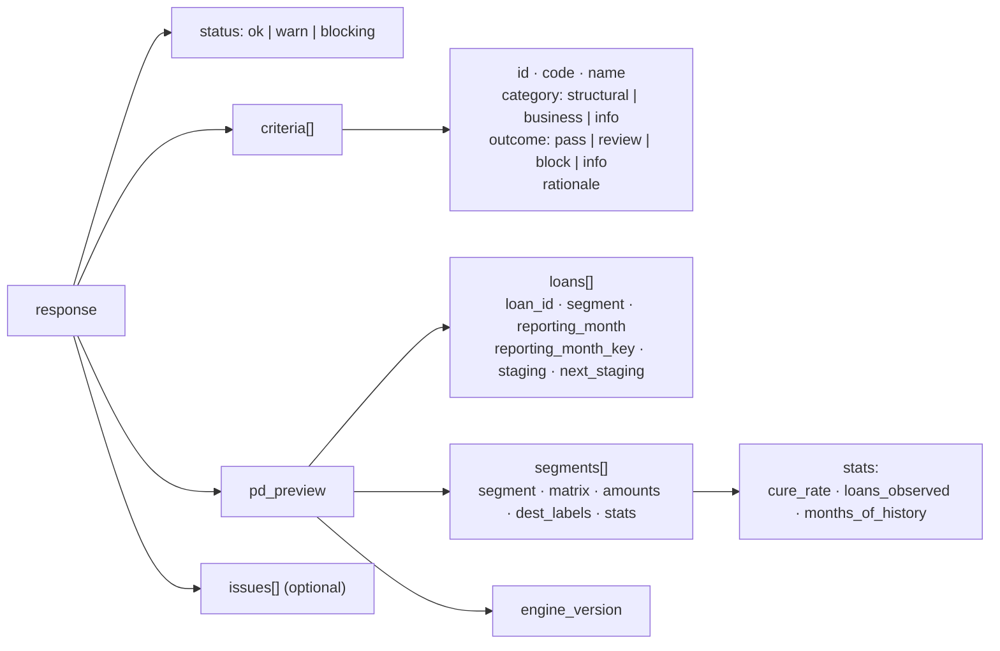
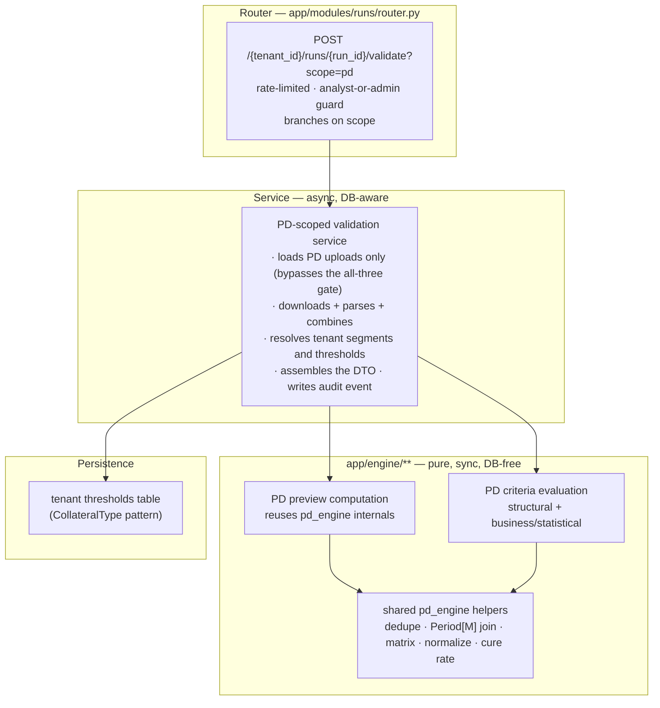

# PD Validation & Preview — Backend Build Prompt

**How to use this document:** this is the brief. Give it to Cursor together with the design mockup (`ECL-Web/references/v2/Flow 5 - New Run.html`) and the functional spec (`ECL/PD_VALIDATION_REDESIGN.md`). It contains no code — the code is the work. It contains the context, the contract, the formulas, and the constraints, because without those the code will be plausible and wrong, and this is audit-facing financial software where plausible-and-wrong is the failure mode that matters.

---

## 1. Mission, and the one non-negotiable principle

Build the backend capability behind `POST /tenants/{tenant_id}/runs/{run_id}/validate?scope=pd`.

When an analyst uploads a Probability-of-Default workbook, that file must go straight to the Python backend, which then — in one inline request — dissects the spreadsheet, validates it on two levels (format/completeness, then business/statistical plausibility), derives each loan's next-month IFRS 9 stage, builds the per-segment transition matrix and cure rate, and returns all of it as a precise, ready-to-render payload.

**The principle, which governs every decision below: all extraction, all validation, and all arithmetic happen in Python. The frontend renders and never derives.**

This is not a stylistic preference. pandas/openpyxl handle Excel dissection, date arithmetic, and matrix algebra with known, testable semantics; scattering equivalent logic across TypeScript would produce a second implementation that drifts from the audited one. The frontend has already been built and audited to this rule — it contains no spreadsheet parser, no staging derivation, no matrix construction, and no pass/fail evaluation. Your job is to feed it.

**Cutover hazard you must flag (and schedule for removal):** the frontend currently falls back to a hardcoded fixture, `ECL-Web/src/lib/pd-validation/mock-pd-preview.ts`, whenever this endpoint returns 400, 404, 422, or 501. Two silent branches in `ECL-Web/src/lib/api/pd-validation.ts` do this — one on a thin response (`!raw.criteria?.length || !raw.pd_preview`), one in the `catch`. Once your endpoint is live, a genuine validation rejection would be swallowed and replaced with fabricated all-green data. Do not modify frontend code as part of this backend task, but state clearly in your handover that those fallbacks must be narrowed to 404/501 immediately and deleted at cutover.

---

## 2. How to execute this

**Start with a research pass, not with code.** Every file path, line number, and function name in this document was verified, but code moves. Re-read from disk before you build: `app/engine/pd_engine.py`, `app/engine/validators/base.py`, `app/engine/validators/pd_validator.py`, `app/modules/runs/service.py`, `app/modules/runs/router.py`, `app/modules/runs/schemas.py`, `app/tasks/compute_tasks.py`, `.cursorrules`, and `.cursor/rules/ecl-backend.mdc`. Where reality differs from this brief, reality wins — say so, then proceed from it.

Then build in layers, bottom-up. The ordering constraint is real: everything depends on the pure engine layer, so it lands first.

1. **Pure engine layer** — the preview computation and the criteria evaluation, as synchronous, DB-free functions under `app/engine/`. These are the precision-critical pieces and the ones that get unit-tested hardest.
2. **Service layer** — the PD-scoped orchestration: load the PD uploads, download, parse, resolve tenant configuration and thresholds, call the pure functions, assemble the DTO, write audit events.
3. **Router layer** — the `scope` parameter and its wiring.
4. **Tests** — engine tests first (they're DB-free and fast), then endpoint tests.

If you split work across parallel agents, split along those seams and let the engine layer complete before the others build on it. A useful division: one agent on the preview computation, one on the criteria evaluation and the thresholds model, one on service/router/tests. Whoever owns the engine layer owns the shared-implementation guarantee in §5.

Before you consider any of it done, `make lint`, `make type-check`, and `make test` must all be clean.

---

## 3. Ground truth — the backend as it actually is today

### 3.1 The existing PD computation, formula by formula

`compute_pd(df)` in `app/engine/pd_engine.py:114` is the audited path that produces the lifetime PD curve feeding ECL. **You are not rewriting it.** You are reusing its internals so the preview and the final computation can never disagree. Its constants: `STAGES = ("Stage 1","Stage 2","Stage 3")`, `NEXT_STAGES = (*STAGES, "Offbooks")`, `MAX_PD_MONTH = 300`, `_DENOM_EPS = 1e-15`, and reporting-month aliases `("Reporting Month", 'Reporting Month ("As At")', "As At")`.

What it does, in order:

| Step | What happens | Detail that matters |
|---|---|---|
| 0 | Resolve the reporting-month column from the alias tuple, rename to canonical `Reporting Month` | Validator's resolver returns `None` when absent; the engine's falls through to a `KeyError` |
| 1 | Parse dates, `drop_duplicates(["Loan ID","Reporting Month"], keep="first")`, stable `mergesort` sort | First-wins in upload-`created_at` then sheet order; the stable sort is a determinism guarantee |
| 2 | Derive `Next Month Staging` by self-joining each row to month *t+1* using `Period[M]` arithmetic; unmatched → `"Offbooks"` | Deliberately not `DateOffset`, which preserves day-of-month and broke Feb/Apr/Jun/Sep/Nov joins, mis-coding live loans as Offbooks |
| 3–4 | Per segment, per reporting month, pivot `Staging → Next Month Staging` summing **Loan Amount**, accumulate into a per-segment aggregate | **Money-weighted (exposure-weighted), not loan-count-weighted.** Built 3×4 including Offbooks, then sliced to `[:, :3]` — the Offbooks column is discarded |
| 5 | Row-normalize the aggregate: `P[i,j] = A[i,j] / Σ_j A[i,j]` | A zero row total leaves the row **all zeros**, silently |
| 6 | `cure_rate = P(S3→S1) + P(S3→S2)` | Taken from the **raw** proportions, *before* Stage 3 is made absorbing |
| 7 | Force the Stage 3 row to `[0,0,1]` | Only row 2 is touched; rows 0 and 1 keep their raw empirical proportions |
| 8–9 | `matrix_power(normalized, n)` for n = 1…300, one output row per (segment, month, starting stage) | Month 1 *is* the normalized one-step matrix |
| 10 | Marginal PD as a discrete hazard rate: `h(n) = (F(n) − F(n−1)) / (1 − F(n−1))`, where `F` is `Stage_3_prob` | `h(1) = F(1)`; when `1 − F(n−1) ≤ 1e-15`, `h` is forced to `1.0`, not 0 |
| 11 | Broadcast each segment's cure rate onto every output row | |

It returns `(output_df, cure_rates, intermediates)`. `output_df` has exactly `SEGMENT, Month, Transition, Stage_1_prob, Stage_2_prob, Stage_3_prob, Marginal_PD, Cure_Rate`. `intermediates` holds `monthly_matrices` (per segment, per month, observed money-weighted amounts), `aggregate` (pooled), `proportion` (row-normalized, pre-absorbing), and `normalized` (the projection matrix).

**Critically: `cure_rates` and `intermediates` are discarded by the caller.** `_pd_main` in `app/tasks/compute_tasks.py:481` throws both away; only `output_df` reaches the `pd_results` table. The intermediates are recomputed later by a *second* `compute_pd` call and used solely to write sheets into the downloadable workbook. **Nothing about derived staging or the observed matrices is reachable through any JSON API today.** The only PD exposure is `_pd_matrix` (`app/modules/results/service.py:436-461`), which returns month-1 rows rounded to 3dp — i.e. the absorbing matrix, post-compute, per segment.

That is the gap you are closing.

### 3.2 The existing validators

`validate_pd(df, *, sheet_name, allowed_segments)` in `app/engine/validators/pd_validator.py:29` runs eight structural checks in order: required columns present (`Loan ID`, `Staging`, `Loan Amount`, `SEGMENT`, plus the resolved reporting-month column); `Loan ID` non-empty; `SEGMENT` non-empty; reporting month parses as a date; `Staging` ∈ `{"Stage 1","Stage 2","Stage 3"}`; `Loan Amount` numeric and ≥ 0; `SEGMENT` ∈ the tenant's configured segments; and `(Loan ID, reporting month)` uniqueness. It short-circuits entirely — running *no* row-level checks — when the reporting-month column is missing.

Three properties of the existing validator layer matter enormously for what you're building:

- **Every primitive in `base.py` emits `block` only.** There is no warning primitive. `check_required_columns`, `check_non_empty_strings`, `check_valid_dates`, `check_enum_values`, `check_enum_values_grouped`, `check_numeric_range`, `check_uniqueness` — all blocking.
- **There is no concept of a check that passed.** `ValidationResult` accumulates `ValidationIssue` objects; a check that succeeds leaves no trace. This is precisely why the current UI can only say "Valid" and not show a checklist.
- **`ValidationIssue` has no code field.** Codes like `EC-06`, `EC-08`, `EC-10` are embedded inside the human-readable `title` string, and `cross_file_validator` attributes issues to files by *sniffing those strings*. The `category` field is used exactly once, for `"template_format"`.

`ValidationResult.add()` silently no-ops once `MAX_ISSUES = 100` is reached, and since `validate_files` constructs a fresh result **per sheet per file**, that cap is not a run-level bound.

### 3.3 The current validate request flow, and the gate that blocks you

`POST /tenants/{tenant_id}/runs/{run_id}/validate` (`app/modules/runs/router.py:135`) is rate-limited at 30/minute, guarded by `require_tenant_analyst_or_admin`, and calls `service.validate_files`, which runs **fully inline in the request** — it downloads every upload from object storage, parses each with pandas, runs all validators, auto-provisions unknown segments and collateral types, runs cross-file checks, writes `upload.validation_status`, logs audit events, and returns. No Celery. `get_db` commits on clean return.

**The blocker** is at `app/modules/runs/service.py:893-901`: if PD, LGD, and EAD are not *all* present, it raises `ECLException("MISSING_UPLOADS", ..., 400)`. This exists because `validate_files` is one monolithic pass that assumes all three kinds. Your PD-scoped path must not go through this gate.

Note also that `validate_files` returns nothing about the data itself — every DataFrame it parses is discarded when the function returns.

### 3.4 The upload and parsing path

`upload_file` (`app/modules/runs/service.py:753`) streams to object storage via `upload_stream` (returning `(sha256, size)`), enforces `settings.max_upload_bytes`, downloads the bytes back to run `_assert_upload_safe` (content-type allowlist plus a zip scan rejecting `vbaProject`), then `_parse_excel`, then persists an `Upload` row with `sheet_count` and `row_count`. PD is exempt from the replace-on-upload rule, so **multiple PD files accumulate**; LGD and EAD replace.

`_parse_excel` (line 443) is `pd.read_excel(buffer, sheet_name=None, engine="openpyxl")` — **all sheets**, no `dtype=`, no `parse_dates=`, no `na_values=`. Type inference is pandas'/openpyxl's: date-formatted cells become `Timestamp`, numerics `float64`, blanks `NaN`, mixed columns `object`. `_combine_sheets` concatenates non-empty sheets with `ignore_index=True`.

On the compute side, `_combine_excel_bytes` does the equivalent across multiple files in `Upload.created_at` order — and that ordering is what decides which row wins `drop_duplicates(keep="first")`.

The `Run.combine_pd_files` flag is enforced **only** in the compute path; validation ignores it and always uses all PD files.

### 3.5 Conventions this code must obey

From `.cursorrules` and `.cursor/rules/ecl-backend.mdc`, and the canonical module `app/modules/segments/`:

- New modules are vertical slices: `{__init__,models,schemas,service,router}.py`, registered in `app/routers.py::_register_routers` with `prefix="/api/v1"`.
- Routers are thin HTTP; all business logic is in `service.py`; enums live in `core/` (run-domain enums are in `app/core/run_enums.py`), never inline.
- Services are **module-level `async def` functions, not classes**. They call `db.flush()` and **never `db.commit()`** — `get_db` commits. They return Pydantic `*Out` objects, never ORM models. Every query on tenant-scoped data includes `tenant_id` in the WHERE clause, plus `deleted_at.is_(None)`.
- Errors are `ECLException(code, detail, status_code)` from `app/core/exceptions.py` with SCREAMING_SNAKE codes — never raw `HTTPException`.
- Responses use a per-module envelope class holding `data:` — never a bare dict.
- IDs are ULID strings, `String(26)`, generated explicitly via `new_ulid()` (which lives in `app/core/security.py`, despite what `.cursorrules` says).
- **`app/engine/**` is pure, synchronous, and DB-free.** It never imports models and is never `async`. Tenant configuration is resolved in the service layer and passed in as **keyword-only arguments** — exactly how `allowed_segments` reaches `validate_pd` today via `_allowed_segments` (`app/modules/runs/service.py:391`). Your thresholds must follow this same discipline.
- Tenant-configurable values follow the `CollateralType` pattern: a tenant-scoped table with `Numeric` parameter columns, ULID PK, indexed `tenant_id`, timestamps and `deleted_at`.
- `mypy --strict` and `ruff` (`E,F,I,UP,B,SIM`, line length 100) must pass. pandas and numpy are **not** in the `ignore_missing_imports` allowlist, so DataFrame-handling code needs real annotations.
- New models must be added to the import block in `migrations/env.py` (or autogenerate will try to drop the table) and to `_CLEAN_ORDER` in `tests/conftest.py`.
- Migrations via `make migrate-new MSG="..."`, then hand-check the generated file against neighbouring ones (indexes, and the `set_updated_at` trigger).

---

## 4. The contract you must fulfill

The frontend already calls this endpoint and already has types for the response. The shape below is not a proposal — it is what the client sends and expects today.

**Request:** `POST /tenants/{tenant_id}/runs/{run_id}/validate?scope=pd`, body `{}`, client timeout 180 s.

**Response**, inside the standard `data:` envelope:

Four subtleties that will silently corrupt the display if you get them wrong:

1. **`cure_rate` is a fraction, not a percentage.** The UI multiplies by 100. Send `0.091` to display "9.1%".
2. **`amounts` are pre-formatted display strings**, e.g. `"148.6M"` — a 2-D array parallel to `matrix`. The frontend does no number formatting for these; the backend owns the abbreviation and the precision shown.
3. **`matrix` must arrive row-normalized.** The frontend never sums a row or normalizes. It renders values as probabilities directly.
4. **`reporting_month_key` must always be supplied**, in sortable `YYYY-MM` form. The frontend has a fallback parser that only understands English three-letter month abbreviations; supplying the key lets that be deleted.

Also: `staging` and `next_staging` accept `1 | 2 | 3 | "offbooks"`; pick one wire form and be consistent (the frontend coerces several, but that coercion has a silent default that should be removed once you pin the contract). `engine_version` must come from the server — the frontend currently defaults to a hardcoded string when it's missing, which is exactly the kind of quiet lie this whole exercise exists to eliminate.

`dest_labels` exists so the matrix can carry four destination columns — Stage 1, Stage 2, Stage 3, **Offbooks** — which brings us to the most important computational point in this document.

---

## 5. Computation specification

Every number the UI displays must come from these formulas, computed server-side.

### 5.1 The shared-implementation requirement

The preview must reuse the *same functions* `compute_pd` uses — the dedupe-and-sort, the `Period[M]` next-month join, the monthly matrix construction, the row normalization, the cure-rate formula. Do not write a parallel implementation "just for the preview." If the preview and the final computation can drift, they eventually will, and the analyst will have signed off on numbers the engine didn't produce.

Practically this means refactoring `pd_engine.py` so its steps are callable independently, then having both `compute_pd` and the new preview call the same helpers. Keep `compute_pd`'s observable behaviour identical — its output feeds ECL and is covered by existing tests.

### 5.2 The loan-level preview rows

For each loan-month row after dedupe and sort: `loan_id`, `segment`, the reporting month in both display form and sortable `YYYY-MM` key form, the `staging` as given, and `next_staging` **derived by the existing `Period[M]` self-join** — join each row to the same loan's row at month *t+1*; unmatched means the loan left the book, which is `Offbooks`.

Note what this means: the last reporting month in the file will show `Offbooks` for every loan, because there is no *t+1* to join to. That is correct and expected, but it is also the single most confusing thing an analyst will see. Decide deliberately how to present it and say what you decided — either exclude the final month's rows from the preview, or mark them distinctly. Do not let it look like a mass exodus from the book.

### 5.3 The per-segment transition matrix

Built per segment from the money-weighted pivot of `Staging → Next Month Staging`, summing `Loan Amount`, aggregated across all reporting months, then row-normalized.

**The Offbooks column must be retained for the preview.** Today `_build_monthly_matrix` constructs the full 3×4 including Offbooks and then discards it with `matrix[:, :3]`. The Markov projection legitimately needs the 3×3 (an absorbing-state model over the three stages), but the *preview* shows a 3×4 with Offbooks as a destination — that's what the mockup renders and what `dest_labels` is for. So: have the shared helper return the full 3×4, let the projection path slice it, and let the preview path keep it.

Be explicit about what this changes: when Offbooks is retained, the row-normalization denominator includes off-book exits, so the displayed probabilities are *conditional on everything that happened*, whereas the projection's 3×3 normalization treats exits as if they never existed. These are different numbers and both are correct for their purpose. Document which is which in the response and in the UI copy, because an auditor comparing the preview matrix to the computed PD curve will otherwise think one of them is wrong.

`amounts` is the pre-normalization aggregate — the actual money in each cell, formatted for display.

### 5.4 Per-segment stats

- `cure_rate` — `P(S3→S1) + P(S3→S2)` from the raw proportions, before Stage 3 is made absorbing, as a fraction.
- `loans_observed` — define this precisely and consistently: distinct `Loan ID` count within the segment, not row count. Say which you used.
- `months_of_history` — the count of distinct reporting months present for that segment. Note that *transitions* observed is one fewer than months present, and EC-13 is about transitions, not months.

---

## 6. Criteria specification

### 6.1 The data-model change

The frontend needs `{id, code, name, category, outcome, rationale}` per criterion, where `outcome` includes **`pass`** — a check that ran and succeeded. The existing `ValidationResult`/`ValidationIssue` model cannot express this: it only accumulates failures, and it has no code field.

Introduce a criterion-result type alongside the existing one. Do **not** retrofit the existing issue model — LGD, EAD, and cross-file validation all depend on its current behaviour, and this task is PD-only. The PD path produces both: criteria (the full checklist, including passes) and issues (the blocking failures, for the existing issue-list UI and `upload.validation_status`). Derive the issues from the blocking criteria rather than running everything twice.

Give each criterion a stable machine-readable `code` as a real field. Do not continue the practice of embedding codes in human-readable titles and string-sniffing them later.

### 6.2 The criteria

Structural criteria already exist as checks in `pd_validator.py` — restate them as criteria that report `pass` as well as `block`, keeping their current logic and messages. Note that the EC-numbering in `test_data/README.md` is **shared across the PD, LGD, and EAD validators** and is not a contiguous PD-only block; `EC-10` (duplicate `Loan ID` + reporting month) is the one verifiably PD-specific code. Do not invent codes for the others — assign them deliberately, document the assignment, and keep it stable thereafter, since these codes will appear in audit records.

| Code | Criterion | Type | Logic | Outcome |
|---|---|---|---|---|
| — | Required columns present | structural | The five required columns exist | block on failure |
| — | Loan ID present | structural | No blank `Loan ID` | block |
| — | Segment present | structural | No blank `SEGMENT` | block |
| — | Reporting month valid | structural | Parses as a date | block |
| — | Staging value valid | structural | ∈ {Stage 1, Stage 2, Stage 3} | block |
| — | Loan amount non-negative | structural | Numeric and ≥ 0 | block |
| — | Segment recognized | structural | ∈ tenant's configured segments | block |
| EC-10 | No duplicate rows | structural | `(Loan ID, reporting month)` unique — **and see §7 on cross-sheet scope** | block |
| EC-11 | Chronological month coverage | business | Per segment, the sorted distinct reporting months have no gap greater than one calendar month | warn (review) |
| EC-12 | Loan ID format consistency | business | Loan IDs conform to a single dominant pattern; flag outliers | warn |
| EC-13 | Minimum transition history | statistical | Per segment, observed month-to-month transitions ≥ threshold. Remember: transitions = distinct months − 1 | warn |
| EC-14 | Stage-mix plausibility | statistical | Per segment, the Stage 3 share falls within a configured band | warn |
| EC-15 | Marginal PD bounds | statistical | Every computed marginal PD ∈ [0,1] and cumulative default probability is non-decreasing per (segment, starting stage) | **block** — a violation means an engine or data defect, not a portfolio state |
| EC-16 | Cure rate sanity | statistical | Per segment, cure rate within a configured band | warn |
| EC-17 | Offbooks rate sanity | statistical | Per segment/month, the Offbooks share versus that segment's trailing average is within a band | warn |
| EC-18 | Reproducibility / engine version | info | Always present, never pass/fail; carries the engine version and the determinism assertion | info |

**Add one criterion this brief is introducing beyond the original spec**, because §3.1 revealed the failure mode it catches: **degenerate transition rows.** When a segment has zero observed exposure in a starting stage, `_row_proportions` leaves that row all zeros, and every projected month for that starting stage yields `Marginal_PD = 0` — silently, forever. Today nothing warns. This must surface as a criterion, because a segment quietly reporting zero lifetime PD for Stage 2 is exactly the kind of error that survives review and lands in a financial statement.

### 6.3 Thresholds

EC-11's gap tolerance, EC-13's minimum transition count, EC-14's stage-mix band, EC-16's cure-rate band, and EC-17's offbooks band must be **tenant-configurable**, following the `CollateralType` pattern: a tenant-scoped table with ULID PK, indexed `tenant_id`, `Numeric` parameter columns, timestamps, and `deleted_at`. Ship sensible defaults and auto-provision them for tenants that have none, mirroring how segments and collateral types are auto-provisioned during validation today.

Resolve them in the service layer and inject them into the pure engine functions as keyword-only arguments. The engine must not know a database exists.

If you need to phase this, the acceptable interim is module-level default constants with the injection seam already in place — so adding the table later touches only the service. What is *not* acceptable is hardcoding thresholds inside the evaluation logic where they can't be overridden.

---

## 7. Precision and determinism

This section exists because the request was explicit about precision. Each item below is a real hazard found in the current code, not a hypothetical.

**Fix or explicitly guard these:**

- **The month-collision cartesian merge.** The `Period[M]` self-join is many-to-one only if `(Loan ID, calendar month)` is unique. Dedupe is on `(Loan ID, exact date)`, so two rows in the same month with different day-of-month values both survive and the merge **expands row count**, corrupting the matrix. Guard this explicitly — detect and surface it rather than letting it silently inflate exposure.
- **Cross-sheet and cross-file duplicates.** Uniqueness is checked per sheet, so duplicates spanning sheets or spanning multiple PD files are never flagged — they're silently resolved later by `drop_duplicates(keep="first")`, where the winner depends on upload timestamp ordering. Since PD explicitly supports multiple files, EC-10 must be evaluated over the **combined** frame, not per sheet.
- **Non-data sheets.** `sheet_name=None` reads every sheet, including instruction or README tabs shipped in the template. These are currently validated and concatenated as if they were data. Decide a rule — a known data-sheet name, or a heuristic on required columns — and apply it consistently between validation and computation.
- **Degenerate rows.** Covered as a criterion in §6.2; the point here is that it must never be silent.
- **The issue cap.** `MAX_ISSUES = 100` is per-`ValidationResult`, created per sheet per file, so it is not a run-level bound. Whatever cap the PD path applies, make it a real one and report truncation honestly.
- **Storage precision.** `PdResult` probability columns are `Numeric(10,8)` — quantized to 1e-8 — while the downloadable workbook is written from a *second, independent* `compute_pd` call at full float64. The two therefore disagree below 1e-8, and `compute_pd` runs twice per run. Don't fix this as part of this task, but don't make it worse: the preview must not become a third independent computation.
- **Stale engine metadata.** `ENGINE_VERSION` is `"v1.0.0"`; `PD_METHOD` claims "299 monthly powers, normalized Stage 1/3 rows" while the code performs 300 powers and normalizes only Stage 3. The frontend separately defaults to `"v1.0.3"`. Reconcile these — the version you return in `engine_version` is what an auditor will use to reproduce a result, so it must be true.

**Rules to hold to:**

- Round only at the presentation boundary. Intermediate arithmetic stays full float64. The only rounding in the response is what's needed for display (`amounts` strings, and any probability you choose to round for rendering) — and where you round, say so in the field's documentation.
- Preserve determinism: stable sorts (`kind="mergesort"` as the existing code does), no reliance on dict or set iteration order for anything that reaches output, no randomness anywhere.
- **Reproducibility is what EC-18 asserts**, so it must be true: the same workbook, validated twice against the same engine version and the same tenant thresholds, must produce byte-identical criteria outcomes and preview numbers. The preview must be side-effect-free — it computes and returns, it does not persist results into `pd_results` or mutate the run's compute state.
- Excel numbers arrive as IEEE-754 doubles, so money-weighted sums are order-dependent at the ~1e-16 level. This is acceptable and unavoidable, but it's another reason the sort order must be stable rather than incidental.

**One decision to make deliberately and record:** whether the preview is persisted for audit. The argument against is that a deterministic computation reproducible from stored inputs plus a stamped engine version is a *stronger* audit guarantee than a stored snapshot, and it avoids a new table. The argument for is that "what the analyst actually saw before confirming" has independent evidentiary value. Recommendation: don't persist the preview payload; do write an audit event recording that PD validation ran, with the run, the engine version, and the resulting status. State your decision either way.

---

## 8. Architecture

Where things go:

- **`app/engine/`** — a new pure module for the preview computation, and a new pure module for criteria evaluation beside the existing validators. Both synchronous, both DB-free, both taking tenant configuration as keyword-only arguments. Refactor `pd_engine.py` to expose the shared steps rather than duplicating them.
- **Service** — a PD-scoped path that does not pass through `validate_files`' all-three-kinds gate. Whether this lives as a new function in `app/modules/runs/service.py` or as its own module is your call; it is PD-specific and substantial, which argues for its own module, but it shares the download/parse helpers, which argues for staying put. Decide and justify briefly.
- **Router** — add the `scope` parameter to the existing route rather than creating a second endpoint, because that is what the frontend already calls. When `scope=pd`, take the PD path; otherwise preserve today's behaviour **exactly** — LGD, EAD, and cross-file validation must be untouched.
- **Inline, not Celery.** Existing validation already runs synchronously in the request, and the preview is a handful of pandas operations over one workbook — far short of the multi-minute pipeline Celery exists for. Keep the existing rate limit. If profiling on realistic file sizes shows this can't hold, say so rather than quietly moving it to a task, because async would change the frontend contract.

One scale note: the frontend paginates the loan preview **client-side**, meaning it expects every preview row in one payload. Check this against realistic file sizes. If a real portfolio makes that payload unreasonable, flag it as a contract change to negotiate — don't unilaterally truncate the data, because a silently truncated preview is a correctness problem, not a performance optimization.

---

## 9. Testing

Follow the existing conventions: engine and validator tests are **DB-free synchronous pytest functions over hand-built DataFrames** (see `tests/test_engine_pd.py` and `tests/test_validators.py`); endpoint tests use real PostgreSQL through the `client` fixture — the rules are explicit that the database is never mocked.

Cover at minimum:

- **Each formula independently**: the next-month join including the month-boundary cases that motivated `Period[M]` (February, and 30- vs 31-day months); the money-weighted matrix including the Offbooks column; row normalization including the zero-total row; the cure-rate formula; and marginal-PD bounds.
- **Each criterion**, both outcomes — a fixture that passes and one that fails — plus the edge cases: a single-month file (no transitions observable at all), a segment with one loan, a gap in the month sequence, duplicate rows spanning two sheets and spanning two files, a file where the last month makes every loan look Offbooks.
- **The precision hazards in §7**, each with a regression test — particularly the month-collision merge, since it silently changes row counts.
- **Determinism**: the same input validated twice yields identical output.
- **The endpoint**: happy path, plus one test per error case — no PD file uploaded, unparseable workbook, blocking structural failure, run not found, wrong tenant (tenant isolation is tested explicitly elsewhere; follow that pattern).

The deterministic dataset under `test_data/` and its generator (`scripts/generate_test_data.py`, seeded) is a ready-made fixture source, and `test_data/README.md` documents which transitions it deliberately exercises.

---

## 10. Definition of done, and what's out of scope

Done means:

- `POST .../validate?scope=pd` returns the §4 contract, computed entirely server-side, for a real uploaded workbook.
- The preview and `compute_pd` share one implementation of every shared formula (§5.1).
- The criteria checklist reports passes as well as failures, with stable machine-readable codes, and thresholds are tenant-configurable through the injection seam.
- Every hazard in §7 is either fixed or explicitly guarded with a test.
- The default (non-`scope`) validate path behaves exactly as before — verified, not assumed.
- `make lint`, `make type-check`, `make test` are clean; new models are registered in `migrations/env.py` and `tests/conftest.py::_CLEAN_ORDER`; the migration has been hand-checked.
- The handover states the decisions this brief asked you to make and record: the final-month Offbooks presentation, `loans_observed`'s definition, preview persistence, the EC-code assignment, and where the service lives.

Out of scope: LGD, EAD, and cross-file validation behaviour; the frontend (the mock-fallback removal is a flagged follow-up, not this task); the `Numeric(10,8)` storage precision and double-`compute_pd` issues (documented, deliberately not fixed here); and the Results Explorer's existing client-side portfolio-coverage arithmetic, which violates the same principle as the mock but belongs to a different feature.
